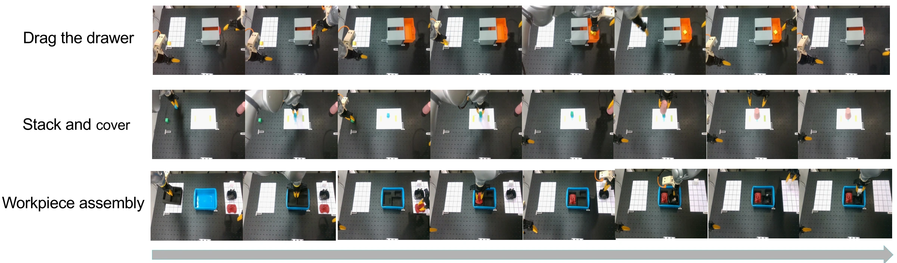
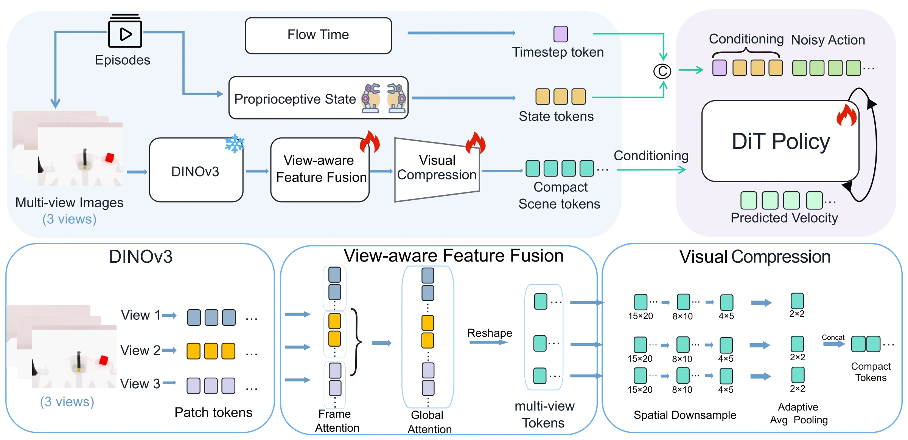

<div align="center">

<picture>
<source media="(prefers-color-scheme: dark)" srcset="assets/rtpolicy-wordmark-dark.svg">

</picture>

<h2>Real-Time (32.9 Hz) Multi-View Visuomotor Policy<br>for Robotic Manipulation on Edge Devices</h2>

<p>
<b>Xianbao Hou</b><sup>1,3,*</sup> · <b>Zehao Ni</b><sup>2,3,*</sup> · <b>Yonghao He</b><sup>4,†</sup> · <b>Lingfeng Qian</b><sup>3</sup><br>
<b>Xin Shi</b><sup>3</sup> · <b>Hu Su</b><sup>5</sup> · <b>Wei Sui</b><sup>3,✉</sup> · <b>Cong Yang</b><sup>1,✉</sup>
</p>

<p>
<sup>1</sup>School of Future Science and Engineering, Soochow University<br>
<sup>2</sup>Shanghai Research Institute for Intelligent Autonomous Systems, Tongji University<br>
<sup>3</sup>D-Robotics &nbsp; <sup>4</sup>Intime AI<br>
<sup>5</sup>State Key Laboratory of Multimodal Artificial Intelligence Systems,<br>Institute of Automation, Chinese Academy of Sciences
</p>

<p><sup>*</sup>Equal contribution &nbsp; <sup>†</sup>Project lead &nbsp; <sup>✉</sup>Corresponding authors</p>

<p align="center">
<a href="https://github.com/D-Robotics-AI-Lab/RTPolicy"></a>
<a href="https://github.com/D-Robotics-AI-Lab/RTPolicy.project"></a>


<a href="LICENSE"></a>
</p>



**Multi-view perception. Compact visual tokens. Four-step action generation.**

</div>

RTPolicy turns multiple RGB views and robot state into action chunks with a compact
flow-matching policy. It combines multi-view reasoning with a deployment path for
edge devices, reaching **32.9 Hz on S600 in INT16** in the paper's latency evaluation.

[Introduction](#1-introduction) · [Model overview](#2-model-overview) · [Getting started](#3-getting-started) · [Training and deployment](#4-training-export-and-inference)

## 🔥 Updates

Release updates, paper links, demonstration videos, and model downloads will be added here.

## 1. Introduction

### 1.1 Brief Introduction of RTPolicy

<div align="center">

</div>

RTPolicy fuses dense visual features across cameras before compressing them, retaining
cross-view information in a small representation for the action model.

- **Reason across views.** A frozen DINOv3 ConvNeXt backbone and view-aware feature fusion
  combine complementary observations from three RGB cameras.
- **Compress before action generation.** At 480 × 640 inputs, visual compression reduces
  **900 visual tokens to 12**, giving the DiT a compact observation representation.
- **Generate action chunks in four steps.** A flow-matching DiT conditions on the visual
  representation and robot state to predict actions with four integration steps.

The policy uses RGB images and robot state; language instructions and point clouds are
not required as policy inputs.

### 1.2 Repository Structure

| Path                                                           | What to find                                                        |
| -------------------------------------------------------------- | ------------------------------------------------------------------- |
| [`drrm/models/policy/rtpolicy/`](drrm/models/policy/rtpolicy/) | Visual encoder, multi-view fusion, adapters, DiT, and policy runner |
| [`drrm/datasets/`](drrm/datasets/)                             | Dataset readers and preprocessing interfaces                        |
| [`drrm/trainer/`](drrm/trainer/)                               | Training and ONNX export                                            |
| [`configs/`](configs/)                                         | Training, observation, robot, and export configurations             |
| [`simulation/robotwin2.0/`](simulation/robotwin2.0/)           | RoboTwin2.0 environments and RTPolicy adapter                       |
| [`scripts/`](scripts/) · [`tools/`](tools/)                    | Evaluation, inference, TensorRT tools, and dataset preparation      |
| [`docs/`](docs/)                                               | [Runtime guide](docs/README.md)                                     |

The import package remains `drrm`; the policy classes are named `RTPolicy*`.

## 2. Model Overview

Results below are reported in the paper. **GPU task success and edge-device latency
are separate evaluations**; the success rates are not measurements on S600 or S100.

### 2.1 RoboTwin2.0 Simulation

The clean-to-clean benchmark uses 50 tasks, 50 clean demonstrations per task,
100 evaluation episodes per task, and task-specific checkpoints.

| Method           | Mean success rate · 50 tasks |
| ---------------- | ---------------------------: |
| Diffusion Policy |                        28.0% |
| ACT              |                        29.7% |
| RDT              |                        34.5% |
| π0               |                        46.4% |
| **RTPolicy**     |                    **52.3%** |

Baseline scores are taken from the official single-task leaderboard (Table I).

### 2.2 Real-World Manipulation

GPU evaluation uses an RTX 4090, 200 demonstrations per task, 150K training steps,
and 50 trials per task. Each method uses its native camera configuration: one view
for DP / VO-DP, and three views for π0.5 / RTPolicy.

| Method                                    |  Drawer | Stack & cover | Assembly |      Mean |
| ----------------------------------------- | ------: | ------------: | -------: | --------: |
| Diffusion Policy                          |     80% |            8% |       0% |     29.3% |
| [VO-DP](https://arxiv.org/abs/2510.15530) |     84% |           34% |       4% |     40.7% |
| π0.5                                      |     88% |           56% |      12% |     52.0% |
| **RTPolicy**                              | **92%** |       **94%** |  **30%** | **72.0%** |

### 2.3 Latency on GPU and Jetson

| Platform            | Precision |   Latency | Frequency |
| ------------------- | --------- | --------: | --------: |
| RTX 4090            | FP32      |  23.80 ms |   42.0 Hz |
| RTX 4090            | FP16      |  10.92 ms |   91.6 Hz |
| Jetson Orin NX 16GB | FP32      | 266.30 ms |    3.8 Hz |
| Jetson Orin NX 16GB | FP16      | 143.20 ms |    7.0 Hz |

Values are reported in Table VII. Precision labels follow that table.

### 2.4 Latency on S600 and S100

| Platform | Precision |      Latency |   Frequency |
| -------- | --------- | -----------: | ----------: |
| **S600** | **INT16** | **30.35 ms** | **32.9 Hz** |
| S600     | INT8      |     18.59 ms |     53.8 Hz |
| S100     | INT16     |    149.72 ms |      6.7 Hz |
| S100     | INT8      |     86.56 ms |     11.6 Hz |

Batch-1 policy latency includes visual encoding and action generation; it is not
full camera-to-actuation latency.

#### Quantization HTML Reports

| Device                  | Precision | Original HTML file                                                                                                   |
| ----------------------- | --------- | -------------------------------------------------------------------------------------------------------------------- |
| S600 · nash-p · 4 cores | INT16     | [S600.html](https://github.com/D-Robotics-AI-Lab/RTPolicy.project/raw/refs/heads/main/assets/quantization/s600.html) |
| S100 · nash-e · 1 core  | INT16     | [S100.html](https://github.com/D-Robotics-AI-Lab/RTPolicy.project/raw/refs/heads/main/assets/quantization/s100.html) |

Download the complete self-contained file and open it in a browser. These are
original HBDK compiler reports; their performance entries are compiler estimates.

### 2.5 Model Downloads

| Resource                        | Availability   |
| ------------------------------- | -------------- |
| Paper / arXiv                   | To be released |
| Demonstration videos            | To be released |
| Policy checkpoints              | To be released |
| S600 / S100 deployment packages | To be released |

## 3. Getting Started

### 3.1 Installation

Use Python 3.10 and a hardware-compatible PyTorch installation. The reference
environment uses PyTorch 2.7.1, torchvision 0.22.1, LeRobot 0.3.3, and transformers 4.56.0.

```bash
git clone https://github.com/D-Robotics-AI-Lab/RTPolicy.git
cd RTPolicy
python -m pip install -e .
```

For an existing compatible environment, append `--no-deps` to the editable install.
The locked cluster dependencies are provided in [`requirements_cluster.txt`](requirements_cluster.txt).

### 3.2 Prepare Data and Weights

Supply compatible DINOv3 weights and set
`model.obs_encoder.emvis_config.backbone_path` to their directory. Datasets,
checkpoints, simulator assets, and generated outputs are kept outside Git.

The [runtime guide](docs/README.md) covers RobotWin-format data preparation,
dataset conversion and checkpoint compatibility. LeRobot is the default data
format; Lance storage is optional.
For RoboTwin2.0 simulation, prepare SAPIEN, Vulkan, cuRobo, and the official assets:

```bash
cd simulation/robotwin2.0
bash script/_download_assets.sh
cd ../..
```

## 4. Training, Export and Inference

### 4.1 Train a Policy

This is a starter training example. Select a robot configuration, dataset, and
training budget appropriate to your experiment; it is not the complete paper protocol.
Point `RTPOLICY_ARTIFACT_DIR` to external artifact storage, such as your EFS mount.

```bash
export DATASET_ROOT=/path/to/lerobot/task_parent
export RTPOLICY_ARTIFACT_DIR=/path/to/external/storage/rtpolicy

WANDB_MODE=disabled accelerate launch --config_file configs/accelerate_config.yaml \
  main.py --config-path=configs/rtpolicy_train \
  --config-name=dit_fm_dinov3cnnl_3v_bs256 \
  +observation_config=dinov3cnnl_3v_cnn_b \
  train_dataset.path="$DATASET_ROOT" train_dataset.task=beat_block_hammer \
  train_dataset.demo=100 horizon=30 n_obs_steps=1 train_dataset.pad_after=28 \
  train_batch_size=256 optimizer.lr=2e-4 seed=0 \
  output_dir="$RTPOLICY_ARTIFACT_DIR/beat_block_hammer_100"
```

The supplied Accelerate configuration targets eight GPUs; adjust it for your machine.
See the [runtime guide](docs/README.md) for dataset preparation and configuration details.

### 4.2 Evaluate in RoboTwin2.0

Pass an absolute checkpoint directory. The example selects four integration steps.

```bash
export CHECKPOINT_DIR=/absolute/path/to/checkpoint
RTPOLICY_NFE=4 bash scripts/eval/eval_robotwin2.0_parallel.sh \
  RTPolicy beat_block_hammer agilex_config "$CHECKPOINT_DIR" 100 2 42
```

JPEG input alignment is enabled by default through `RTPOLICY_JPEG_ROUNDTRIP=1`.

### 4.3 Export and Run ONNX

```bash
python -m drrm.trainer.onnx \
  --checkpoint-dir "$CHECKPOINT_DIR" \
  --onnx-path "$RTPOLICY_ARTIFACT_DIR/model.onnx" \
  --device cpu --export-dtype fp32 --image-preprocess-in-onnx --verify

python scripts/infer_onnx.py --help
python scripts/infer_rtpolicy.py --help
```

Install ONNX, ONNX Runtime, and the export dependencies in your deployment environment.
The exported graph follows the checkpoint configuration, including its sampling settings.

### 4.4 TensorRT and Edge Deployment

For compatible NVIDIA TensorRT / CUDA environments:

```bash
python scripts/build_bench_x86.py build \
  "$RTPOLICY_ARTIFACT_DIR/model.onnx" "$RTPOLICY_ARTIFACT_DIR/model.engine"
python scripts/build_bench_x86.py bench \
  "$RTPOLICY_ARTIFACT_DIR/model.engine" /path/to/inputs
```

Jetson conversion and benchmarking helpers are provided in
[`scripts/fp16_convert.py`](scripts/fp16_convert.py),
[`scripts/int8_convert.py`](scripts/int8_convert.py), and
[`scripts/bench_acc_jetson.py`](scripts/bench_acc_jetson.py).
S600 / S100 toolchain instructions and deployment packages will be added separately.

## Acknowledgements

We thank the authors of [DINOv3](https://github.com/facebookresearch/dinov3)
and [VO-DP](https://github.com/D-Robotics-AI-Lab/DRRM) for sharing their research and code.

## Citation

RTPolicy BibTeX and publication details will be added with the paper release.

### Related work: VO-DP

[VO-DP: Semantic-Geometric Adaptive Diffusion Policy for Vision-Only Robotic Manipulation](https://arxiv.org/abs/2510.15530)

Zehao Ni et al., 2025. [Code](https://github.com/D-Robotics-AI-Lab/DRRM) · [Project](https://d-robotics-ai-lab.github.io/vodp/)

```bibtex
@article{ni2025vodp,
  title={{VO-DP}: Semantic-Geometric Adaptive Diffusion Policy for Vision-Only Robotic Manipulation},
  author={Ni, Zehao and He, Yonghao and Qian, Lingfeng and Mao, Jilei and Fu, Fa and Sui, Wei and Su, Hu and Peng, Junran and Wang, Zhipeng and He, Bin},
  journal={arXiv preprint arXiv:2510.15530},
  year={2025},
  url={https://arxiv.org/abs/2510.15530}
}
```

## License

See [LICENSE](LICENSE) for the repository terms. Third-party components retain their
respective licenses.
